<picture>
  <source media="(prefers-color-scheme: dark)" srcset="https://raw.githubusercontent.com/devshahmeerbukhari/devshahmeerbukhari/main/assets/banner-dark.svg" />
  <source media="(prefers-color-scheme: light)" srcset="https://raw.githubusercontent.com/devshahmeerbukhari/devshahmeerbukhari/main/assets/banner-light.svg" />
  
</picture>

 
 

 

---

## 👋 About me

I'm **Muhammad Shahmeer Bukhari**, a full-stack developer who builds **SaaS products** and **AI-native applications** from the first schema to the final deploy.

My sweet spot is where product engineering meets applied AI: fast, polished interfaces in **Next.js and React**, clean service boundaries in **Node.js and Express**, data in **MongoDB**, and retrieval systems powered by **LangChain, OpenAI/Gemini, and Pinecone** when a product needs to be genuinely intelligent.

I care about the things that survive production — typed contracts, observable services, sensible caching, automated deployments, and AI features that are grounded, cited, and evaluated instead of demoed once.

<table>
  <tr>
    <td width="50%" valign="top">
      <b>🧱 SaaS platforms</b> 
      Multi-tenant data models, RBAC, billing flows, dashboards, and onboarding built to scale.
    </td>
    <td width="50%" valign="top">
      <b>🧠 AI &amp; RAG systems</b> 
      Ingestion, embeddings, retrieval, reranking, citations, and evaluation — end to end.
    </td>
  </tr>
  <tr>
    <td width="50%" valign="top">
      <b>⚙️ Microservices &amp; APIs</b> 
      Typed REST contracts, queue-backed jobs, caching, object storage, and observability.
    </td>
    <td width="50%" valign="top">
      <b>📱 Cross-platform apps</b> 
      React Native products that share the same patterns, APIs, and design language as the web.
    </td>
  </tr>
</table>

## 🧰 Tech stack

| | |
| :-- | :-- |
| **Languages** |   |
| **Frontend** |       |
| **Backend** |       |
| **Data** |     |
| **AI / LLM** |       |
| **Mobile** |  |
| **CMS** |  |
| **Cloud / DevOps** |      |
| **Architecture** |    |

## 🧠 Applied AI & RAG engineering

A demo is easy. Production retrieval is the hard part. I build RAG systems as **data pipelines first** and layer the model on top — so answers stay grounded, fast, and measurable.

<picture>
  <source media="(prefers-color-scheme: dark)" srcset="https://raw.githubusercontent.com/devshahmeerbukhari/devshahmeerbukhari/main/assets/rag-pipeline-dark.svg" />
  <source media="(prefers-color-scheme: light)" srcset="https://raw.githubusercontent.com/devshahmeerbukhari/devshahmeerbukhari/main/assets/rag-pipeline-light.svg" />
  
</picture>

- **Ingestion** — normalize PDFs, documentation, web pages, and database content into clean, chunkable text.
- **Retrieval quality** — metadata filters, hybrid search, reranking, and context windows tuned to the task.
- **Grounding** — citations, refusal behavior, and prompt contracts that keep answers inside the source material.
- **Evaluation** — golden question sets, retrieval hit-rate, answer faithfulness, latency, and token cost.
- **Agentic workflows** — tool calling, structured outputs, and multi-step flows orchestrated with LangChain.

## ⚙️ SaaS & microservices

I build products that can start small and grow without a rewrite: clear service ownership, typed boundaries, and deployment automation from day one.

<picture>
  <source media="(prefers-color-scheme: dark)" srcset="https://raw.githubusercontent.com/devshahmeerbukhari/devshahmeerbukhari/main/assets/saas-architecture-dark.svg" />
  <source media="(prefers-color-scheme: light)" srcset="https://raw.githubusercontent.com/devshahmeerbukhari/devshahmeerbukhari/main/assets/saas-architecture-light.svg" />
  
</picture>

- **Multi-tenant foundations** — org-scoped data, role-based access, and audit-friendly models.
- **Independent services** — auth, billing, core product, and AI as separate concerns with clear contracts.
- **Async where it counts** — queue-backed jobs, webhooks, retries, and idempotent handlers.
- **CI/CD from day one** — automated checks, preview environments, and zero-drama releases.
- **Cost-aware infrastructure** — S3 for assets, Redis for hot paths, and vector search where it earns its keep.

## 🚀 Featured work

| Project | What it is | Stack | Links |
| :-- | :-- | :-- | :-- |
| **Dexterz** | CMS-driven corporate web platform with a custom Sanity studio | Next.js · TypeScript · Sanity · MUI · Tailwind | [Live](https://dexter-chi.vercel.app) · [Code](https://github.com/devshahmeerbukhari/dexterz) |
| **Pakistani Panorama** | Tourism discovery platform built as a final-year project | React · TypeScript · Sanity · MUI · Tailwind · Zod | [Live](https://pakistani-panorama-fyp.vercel.app) · [Code](https://github.com/devshahmeerbukhari/pakistanii-panorama-fyp) |
| **InVideo AI** | Cross-platform mobile app built with React Native | React Native · TypeScript · React Navigation | [Code](https://github.com/devshahmeerbukhari/Invideo-AI) |
| **Portfolio** | Personal site with CMS-driven content and motion design | Next.js · TypeScript · Sanity · MUI · Framer Motion | [Live](https://muhammad-shahmeer-bukhari-portfolio.vercel.app) · [Code](https://github.com/devshahmeerbukhari/Portfolio) |

<a href="https://github.com/devshahmeerbukhari?tab=repositories"><b>Explore all repositories →</b></a>

## 📊 GitHub at a glance

## 🐍 Contribution graph

<picture>
  <source media="(prefers-color-scheme: dark)" srcset="https://raw.githubusercontent.com/devshahmeerbukhari/devshahmeerbukhari/output/github-contribution-grid-snake-dark.svg" />
  <source media="(prefers-color-scheme: light)" srcset="https://raw.githubusercontent.com/devshahmeerbukhari/devshahmeerbukhari/output/github-contribution-grid-snake.svg" />
  
</picture>

## 🔭 Currently

- Building **AI-native SaaS** — product surface, APIs, and retrieval in one coherent codebase.
- Going deeper into **agentic workflows, evaluation, and retrieval quality**.
- Exploring the overlap of **LLM tooling, vector search, and product UX**.
- Open to collaborating on ambitious products and well-scoped AI features.

## 🤝 Let's connect

Have a product to build, an AI feature to ship, or a backend that needs untangling? I'd love to hear about it.

 

  Want to see more? Explore my portfolio or start a conversation on GitHub — let's build something worth shipping.

<picture>
  <source media="(prefers-color-scheme: dark)" srcset="https://raw.githubusercontent.com/devshahmeerbukhari/devshahmeerbukhari/main/assets/footer-dark.svg" />
  <source media="(prefers-color-scheme: light)" srcset="https://raw.githubusercontent.com/devshahmeerbukhari/devshahmeerbukhari/main/assets/footer-light.svg" />
  
</picture>
